# Guía del panel de S.E.I.

Esta guía explica las tres tareas más comunes del panel: **subir una obra**, **responder una
consulta** y **publicar un artículo**. Todo funciona igual desde la computadora y desde el celular.

## Entrar al panel

1. Abrí **https://servielect.com.ar/admin** (guardala en favoritos o en la pantalla de inicio del
   celular).
2. Escribí tu email y tu contraseña y tocá **Ingresar**.

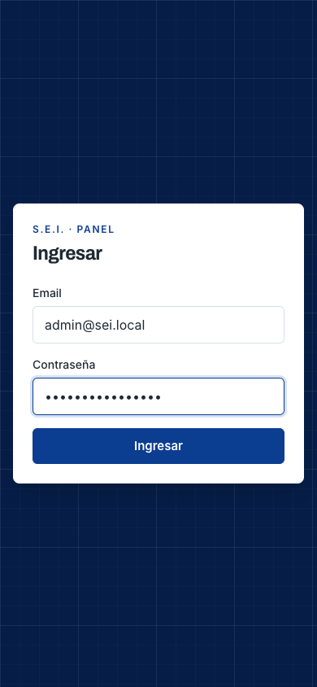

Si te equivocás 5 veces seguidas, el panel se bloquea 15 minutos por seguridad. La sesión dura
12 horas; después te pide la contraseña de nuevo.

En el **Inicio** ves cuántas consultas nuevas tenés sin responder y de qué provincias llegaron
esta semana. En el celular, las secciones están en la barra de abajo.

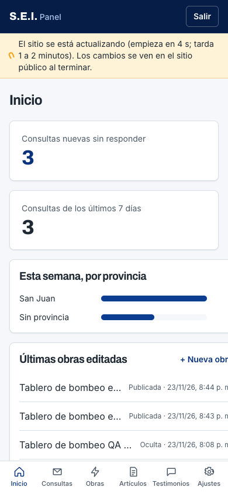

---

## 1. Subir una obra (también desde la obra misma)

1. Andá a **Obras** y tocá **+ Nueva obra**.

   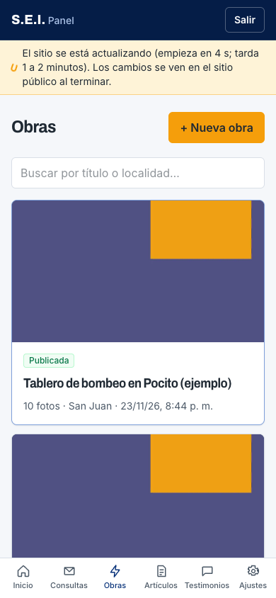

2. Escribí el **título** (por ejemplo, "Subestación para bodega"), un **resumen** de una o dos
   frases, el **tipo de obra** y el **sector**. Tocá **Guardar**.

   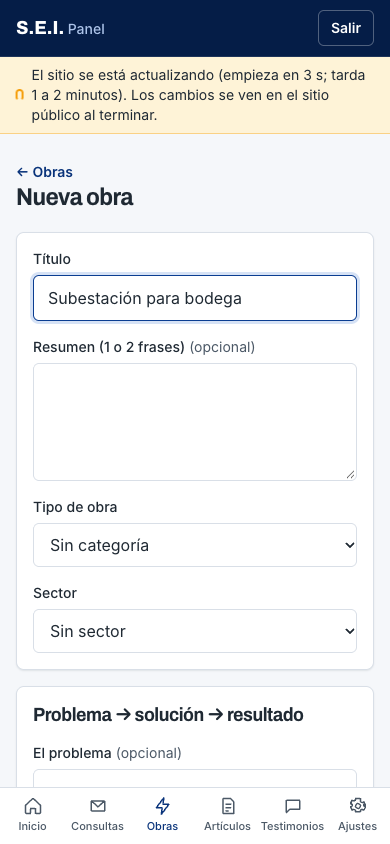

3. Ahora aparece la sección **Fotos**:
   - En el celular, **Sacar foto** abre la cámara: sacás la foto y se sube sola. Repetilo para
     cada foto.
   - **Subir fotos** te deja elegir varias de la galería (hasta 20 por vez).
   - En la computadora también podés arrastrarlas al recuadro.

   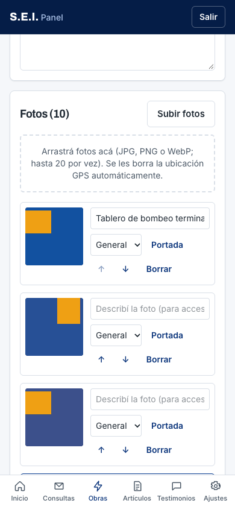

   Las fotos se achican solas para que el sitio cargue rápido, y **se les borra la ubicación GPS**
   y cualquier otro dato del teléfono. Mientras tanto dicen "Procesando…" unos segundos.

4. En cada foto podés:
   - escribir una **descripción** (sirve para personas ciegas y para Google),
   - elegir si es **General**, **Antes** o **Después** (si hay una de cada, la ficha muestra un
     comparador deslizable),
   - marcarla como **Portada** (la que se ve en la galería),
   - cambiar el orden con **↑ ↓** (o arrastrándola en la computadora),
   - **Borrar** la foto.

   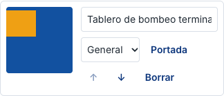

5. Completá **El problema**, **La solución** y **El resultado**, y los datos (provincia,
   localidad, potencia, fecha). Cuanto más completa, mejor se posiciona en Google.
6. Cuando esté lista, marcá **Publicada en el sitio** y tocá **Guardar**. Si querés que aparezca en
   el inicio, marcá también **Destacada**.

   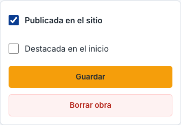

Arriba va a aparecer el aviso **"El sitio se está actualizando"**: en 1 o 2 minutos la obra está en
la galería pública. Mientras la obra no esté marcada como publicada, nadie la ve.

---

## 2. Responder una consulta

Cada vez que alguien completa el Diagnóstico Exprés o el formulario de contacto, te llega un email
con el resumen y un enlace directo a la consulta.

1. Andá a **Consultas**. Las nuevas dicen **Nueva**. Podés buscar por empresa, nombre o email, y
   filtrar por estado, provincia o fechas.

   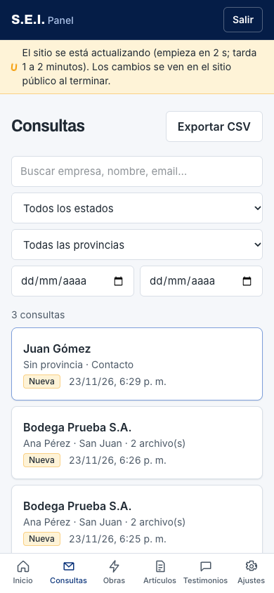

2. Abrí la consulta para ver los datos, los objetivos, el mensaje y los **archivos** (factura y
   presupuesto). Tocá **Descargar** para abrirlos: por seguridad, el enlace vence a los 5 minutos
   (si vence, tocá de nuevo).

   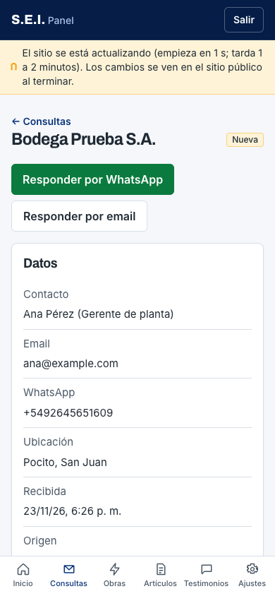

3. Respondé con **Responder por WhatsApp** (abre WhatsApp con un saludo ya escrito) o **Responder
   por email**.
4. En **Seguimiento**, cambiá el **estado** (En análisis, Respondida, Cliente, Descartada) y, si
   querés, dejá una **nota interna**. Todo queda en el **Historial** con fecha y autor.

   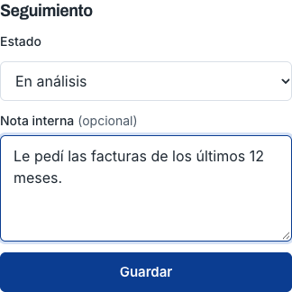

**Exportar CSV** (arriba, en la lista) descarga las consultas filtradas para abrirlas en Excel.

> Privacidad: las consultas en estado **Nueva** o **Descartada** se borran solas, con sus
> archivos, a los 24 meses (Ley 25.326). Las que pasaste a **Cliente** o **Respondida** se
> conservan.

---

## 3. Publicar un artículo

1. Andá a **Artículos** y tocá **+ Nuevo artículo**.
2. Escribí el **título**, un **extracto** (aparece en el listado) y el texto. Para los subtítulos
   usá `## Subtítulo`; para negrita, `**texto**`.

   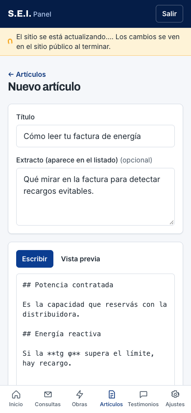

3. Tocá **Vista previa** para ver cómo va a quedar.

   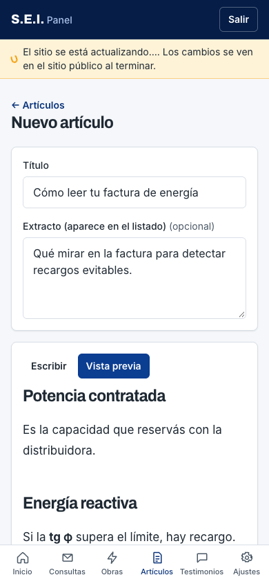

4. Guardá. Después podés **subir una portada** y agregar **etiquetas** (separadas por coma).
5. Para publicarlo:
   - **Publicar ahora**: sale en 1 o 2 minutos.
   - **Programarlo**: elegí una fecha y hora futura en "Fecha de publicación" y guardá. Se publica
     solo a esa hora (el sitio se actualiza dentro de la hora siguiente).
   - Si dejás la fecha vacía, queda como **borrador** y nadie lo ve.

---

## Otras secciones

- **Testimonios**: agregá solo testimonios reales y con permiso. Se publican al marcar
  "Publicado".
- **Ajustes**: teléfonos, email, número de WhatsApp (formato `549` + código de área + número, sin
  espacios), las **cifras del inicio** (solo se muestran las que tienen valor) y el límite de tg φ
  de la calculadora.

## Si algo no funciona

- "El sitio se está actualizando" tarda más de 5 minutos: recargá el panel; si sigue, avisá a
  soporte.
- No podés entrar: esperá 15 minutos si te equivocaste varias veces. Si olvidaste la contraseña,
  soporte la puede cambiar con `make create-admin-prod` (el sistema nunca la envía por email).
